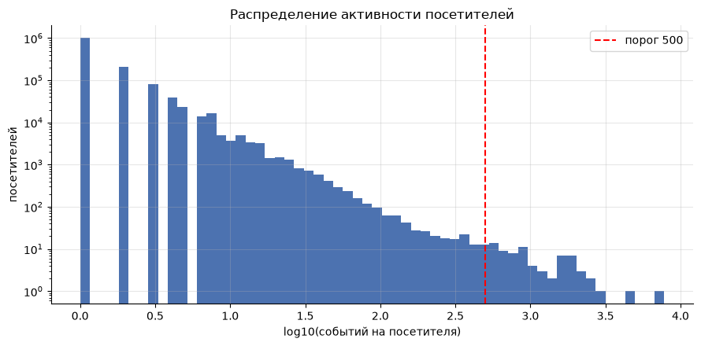
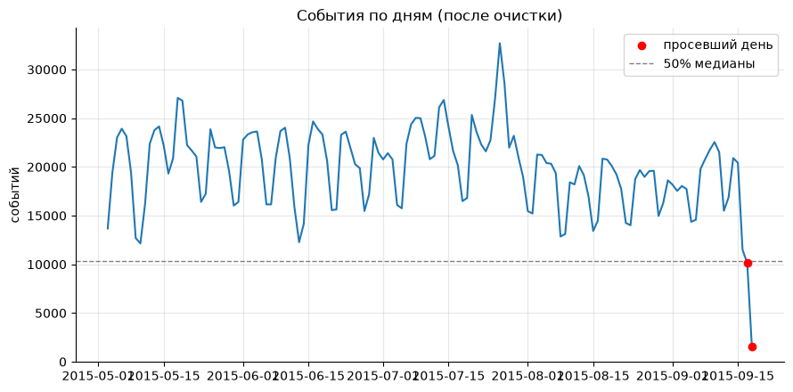
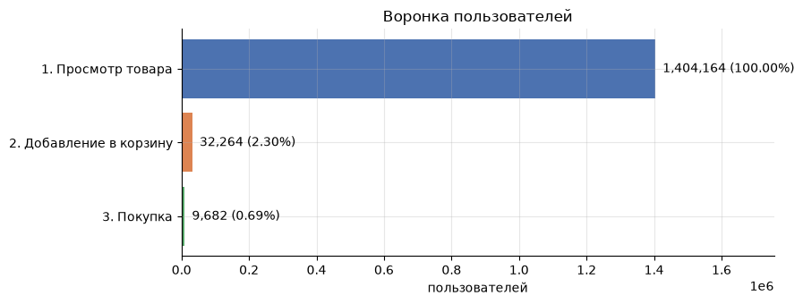
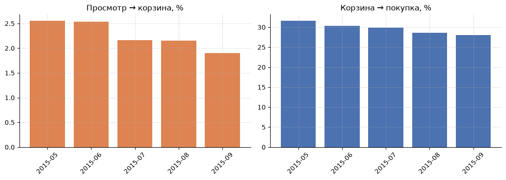
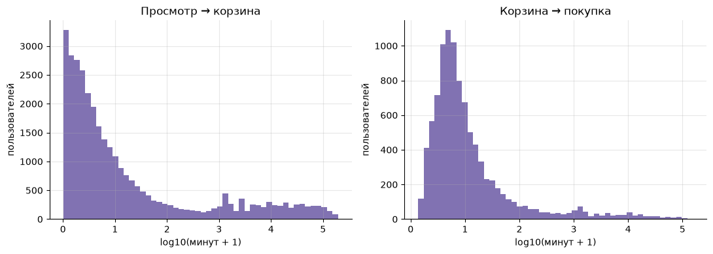
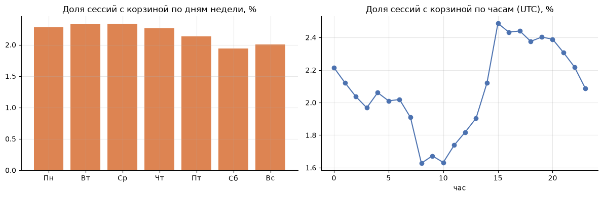
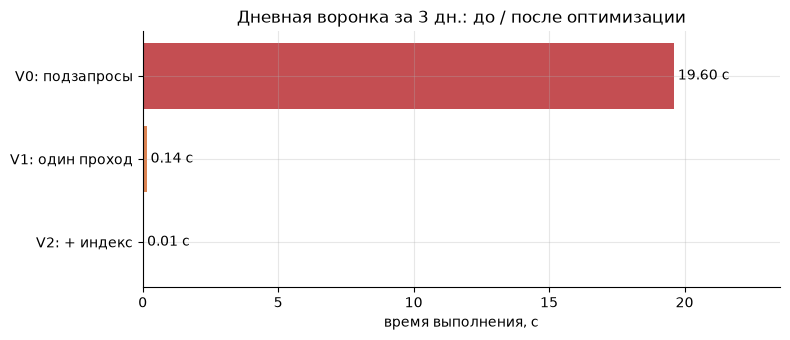
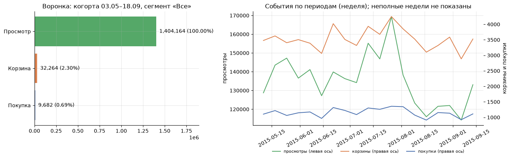

# E-commerce Event Analytics: Data Validation, Funnel, Data Marts and Dashboard in SQL

[](README.md)

[](https://www.python.org/)
[](https://www.sqlite.org/)
[](https://jupyter.org/)
[](https://pandas.pydata.org/)
[](https://matplotlib.org/)
[](https://ipywidgets.readthedocs.io/)

A personal product analytics project: on a real e-commerce event log (2.75M events) it walks the analyst's path from data quality checks to a funnel, data marts, SQL optimization and a dashboard with filters.

## About

Product decisions rely on event data, so first it must be trustworthy, and then we need to see where users drop off on the way to purchase. All logic is written in **SQL (SQLite)**; Python is used to run queries and visualize results.

The project includes:

- **event tracking plan**: what events should look like and the rules to validate them;
- **data validation**: completeness, correctness, duplicates, daily gaps, bots, logical consistency (11 checks with a decision summary table);
- **three data marts**: by session, user and day, with sessions reconstructed using a 30-minute gap;
- **funnel** `view → add to cart → purchase`: by users, cohorts and sessions, time between steps, weekday and hour, cart abandonment;
- **ad-hoc queries**: top items, repeat buyers, one-event visitors;
- **SQL refactoring**: a 1,474× speedup with result equivalence verified;
- **dashboard** with filters (ipywidgets) and notes on porting to Redash;
- **conclusions and recommendations** with limitations.

## Data

[Retailrocket recommender system dataset](https://www.kaggle.com/datasets/retailrocket/ecommerce-dataset), `events.csv`: a real e-commerce log from May 3 to September 18, 2015, **2,756,101 events** from **1,407,580 visitors** and 235,061 items.

| Column          | Description                                          |
|-----------------|------------------------------------------------------|
| `timestamp`     | event time, Unix time in ms (UTC)                    |
| `visitorid`     | visitor identifier                                   |
| `event`         | event type: `view`, `addtocart`, `transaction`       |
| `itemid`        | item identifier                                      |
| `transactionid` | order identifier (filled only for `transaction`)     |

The data is not included in the repository (size and license); download it from Kaggle and place it at `data/events.csv`.

## Data Validation

Each check is recorded in a summary table with the decision taken. The data turned out structurally clean (no missing key fields, invalid event types or out-of-range timestamps); the main findings concern logic and logging completeness:

| Group      | Check                                              | Rows affected          | Decision                              |
|------------|----------------------------------------------------|------------------------|---------------------------------------|
| Duplicates | Exact duplicate events                             | 460                    | removed                               |
| Bots       | Visitors with ≥500 events and no purchases (15)    | 14,308                 | removed                               |
| Duplicates | Fast repeats (< 1 s)                               | 4,698                  | kept, informational                   |
| Logic      | Purchase without this item added to cart           | 2,452 (10.9% of purchases) | kept, counted separately in funnel |
| Logic      | Add-to-cart without viewing this item              | 18,881 (27.4% of carts)    | kept, logging gap                  |
| Dynamics   | Incomplete days at the end (Sep 17 and 18)         | 10,126 + 1,528         | flagged                               |

After cleaning, **2,741,333 events** remain (0.54% removed). There are also 75 visitors with ≥500 events, 60 of them with purchases: they are kept as possibly real buyers.

[](img/activity_distribution.png)

[](img/daily_events.png)

## Data Marts

| Mart           | Granularity | Rows      | Purpose                                   |
|----------------|-------------|-----------|-------------------------------------------|
| `mart_session` | session     | 1,759,613 | session funnel, weekday and hour          |
| `mart_user`    | user        | 1,407,565 | user funnel, cohorts                      |
| `mart_daily`   | day         | 139       | trends and dashboard                      |

## Results

### User Funnel

| Step                | Users     | From previous step | From step 1 |
|---------------------|-----------|--------------------|-------------|
| 1. Item view        | 1,404,164 | 100%               | 100%        |
| 2. Add to cart      | 32,264    | 2.30%              | 2.30%       |
| 3. Purchase         | 9,682     | 30.01%             | 0.69%       |

[](img/funnel_users.png)

Cart abandonment is **72.3%** (37,714 users with a cart, 10,447 bought after it). Session level: 2.21% with a cart, 0.64% with a purchase, **78.3% of sessions have a single event**.

### Cohorts by Month of First View

| Cohort  | View → cart | Cart → purchase | View → purchase |
|---------|-------------|-----------------|-----------------|
| 2015-05 | 2.56%       | 31.6%           | 0.81%           |
| 2015-06 | 2.54%       | 30.4%           | 0.77%           |
| 2015-07 | 2.16%       | 29.8%           | 0.64%           |
| 2015-08 | 2.16%       | 28.6%           | 0.62%           |
| 2015-09 | 1.90%       | 28.0%           | 0.53%           |

[](img/funnel_cohorts.png)

*The September cohort is incomplete (data ends on September 18).*

### Time Between Steps and Seasonality

| Metric                   | p25  | Median | p75   | p90    |
|--------------------------|------|--------|-------|--------|
| View → cart, min         | 0.9  | 3.7    | 36.4  | 5,730  |
| Cart → purchase, min     | 3.0  | 5.8    | 16.0  | 101.9  |

[](img/time_between_steps.png)

Session-to-purchase conversion is 0.65–0.74% Monday to Thursday, 0.58% on Friday and 0.46–0.50% on weekends (Saturday is 37% below Wednesday). The share of sessions with a cart is lowest at 08–10 UTC (≈1.6%) and highest around 15 UTC (≈2.5%).

[](img/weekday_hour.png)

### SQL Optimization

Daily funnel by unique users, same data window, results of all versions verified to match:

| Version                                                  | Time, s | Speedup |
|----------------------------------------------------------|---------|---------|
| V0: correlated subqueries, `substr()`, no index          | 19.59   | ×1      |
| V1: single pass, conditional aggregation                 | 0.143   | ×137    |
| V2: V1 + composite index `(event_date, event, visitor_id)` | 0.013 | ×1,474  |

[](img/sql_optimization.png)

### Dashboard

Filters by period, user segment (by number of sessions) and trend granularity. Data comes from the marts, not from raw events. Widgets work when run in Jupyter; a static snapshot is shown below.

[](img/dashboard_default.png)

## Conclusions

- **The data is usable**, but logging is incomplete: 27.4% of add-to-carts have no prior view of that item, and 10.9% of purchases happen without a cart. The three-step funnel does not fully describe real behavior.
- **Main drop-offs**: 97.7% of users are lost at "view → cart", and **72.3% of those who add to cart do not buy**. Purchase decisions are fast (90% of post-cart purchases happen within 1–2 hours).
- **Conversion declines** from cohort to cohort (view → purchase from 0.81% to 0.53%), while the share of one-event visitors grew from 67.1% to 75.5%. This is consistent with a hypothesis of more "shallow" traffic, but the data has no traffic sources, so it cannot be verified.
- **Weekends** convert worse than weekdays: Saturday is 37% below Wednesday.
- **SQL refactoring** sped up the key query 1,474×, and the marts let the dashboard run on pre-aggregated data.

### Recommendations

- Add `session_id`, a `checkout_started` event, price, quantity and traffic source to logging.
- Run an A/B test on the "cart → purchase" step (for example, a cart reminder): primary metric is cart → purchase conversion.
- Check items with many views and zero carts for orderability.

### Limitations

- No `session_id` (sessions reconstructed with a 30-minute gap), no price, quantity or `checkout` step, hence no revenue.
- No traffic source, platform or device: causes of declining conversion cannot be established.
- Timestamps are UTC, the store's time zone is unknown. Data ends on September 18.
- Identification by `visitorid` ignores device changes and cookie clearing.
- The bot threshold (≥500 events and no purchases) is chosen from the activity distribution. 60 "heavy" buyers are kept and their contribution to purchases was not assessed.

## Repository Structure

```
Ecommerce-Events-Analytics/
├── data/
│   └── events.csv             
├── img/                       # figures for the README
├── notebooks/
│   └── event_analytics.ipynb  # full analysis
├── requirements.txt
├── .gitignore
├── README.md
└── README.en.md
```

## Tech Stack

Written in **Python 3** and **SQL (SQLite)** using Jupyter Notebook.

| Tool                                                | Purpose                                                             |
|-----------------------------------------------------|---------------------------------------------------------------------|
| [`SQLite`](https://www.sqlite.org/)                 | Event storage, quality checks, marts, funnels, window functions (`LAG`, `SUM OVER`) |
| [`pandas`](https://pandas.pydata.org/)              | Data loading, running SQL queries, quantiles                        |
| [`NumPy`](https://numpy.org/)                       | Helper computations                                                 |
| [`Matplotlib`](https://matplotlib.org/)             | Funnel, cohort and distribution plots                               |
| [`ipywidgets`](https://ipywidgets.readthedocs.io/)  | Interactive dashboard filters                                       |

## Installation and Run

1. Install [Python 3](https://www.python.org/downloads/).
2. Clone the repository and install dependencies:

   ```
   git clone https://github.com/DenkiGO/Ecommerce-Events-Analytics.git
   cd Ecommerce-Events-Analytics
   pip install -r requirements.txt
   ```
3. Download `events.csv` from [Kaggle](https://www.kaggle.com/datasets/retailrocket/ecommerce-dataset) and place it in `data/`.
4. Start Jupyter and open `notebooks/event_analytics.ipynb`:

   ```
   jupyter notebook
   ```
5. Run all cells (`Kernel → Restart & Run All`). A full run takes a few minutes. If the file is missing, the notebook generates synthetic data with a warning.
