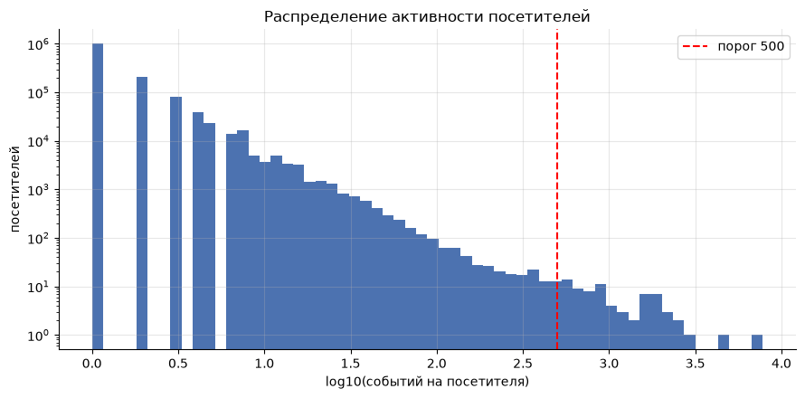
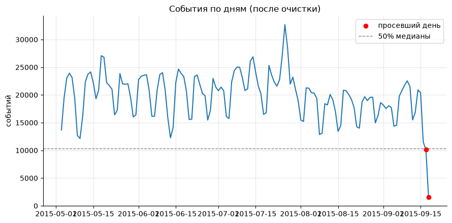
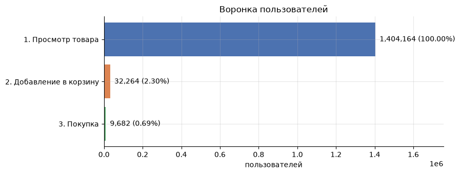
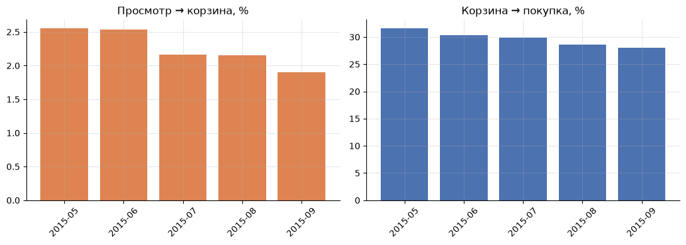
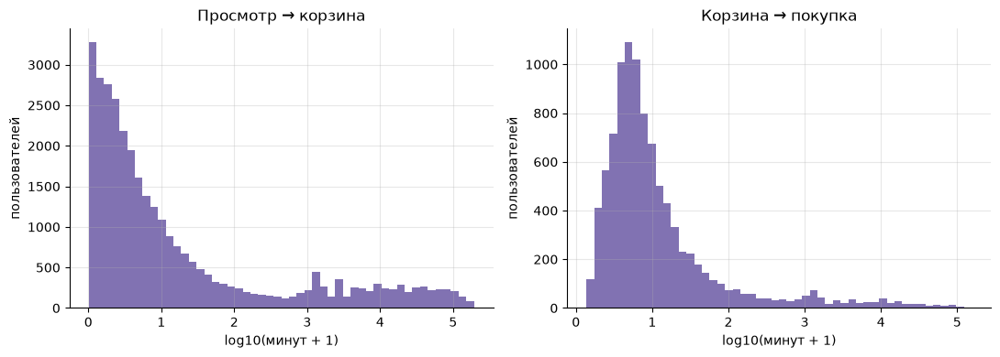
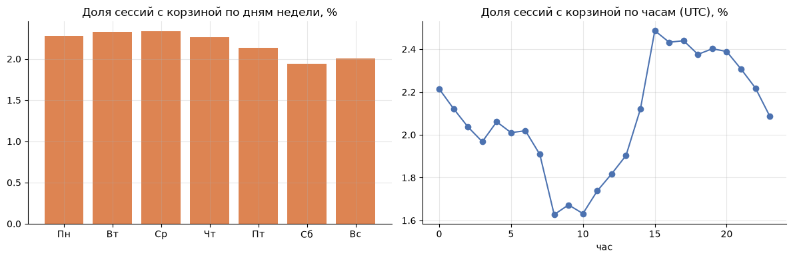
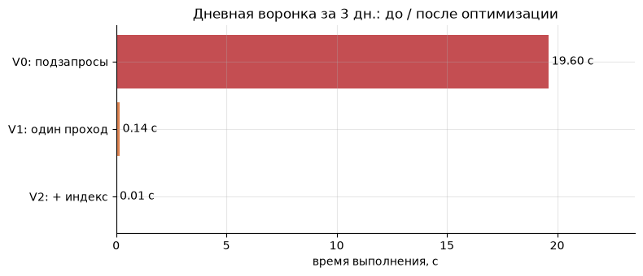
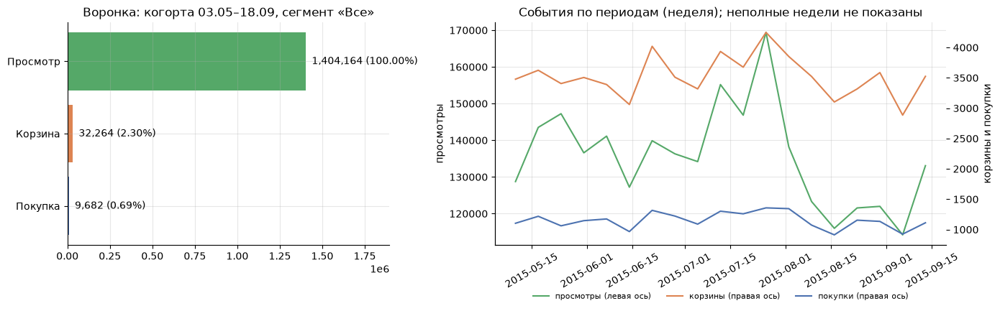

# Событийная аналитика интернет-магазина: валидация данных, воронка, витрины и дашборд на SQL

[](README.en.md)

[](https://www.python.org/)
[](https://www.sqlite.org/)
[](https://jupyter.org/)
[](https://pandas.pydata.org/)
[](https://matplotlib.org/)
[](https://ipywidgets.readthedocs.io/)

Личный учебный проект по продуктовой аналитике: на реальном логе событий интернет-магазина (2,75 млн событий) пройден путь аналитика от проверки качества данных до воронки, витрин, оптимизации SQL и дашборда с фильтрами.

## О проекте

Продуктовые решения принимаются на основе событийных данных, поэтому сначала нужно убедиться, что им можно доверять, а затем понять, где пользователи теряются на пути к покупке. В проекте вся логика написана на **SQL (SQLite)**, а Python используется для запуска запросов и визуализации.

В проекте:

- **план логирования событий** (tracking plan): какими должны быть события и по каким правилам их проверять;
- **валидация данных**: полнота, корректность, дубли, провалы по дням, боты, логическая согласованность (11 проверок со сводной таблицей решений);
- **три витрины данных**: по сессиям, пользователям и дням, с восстановлением сессий по паузе 30 минут;
- **воронка** `просмотр → корзина → покупка`: по пользователям, когортам и сессиям, время между шагами, день недели и час, отказ от корзины;
- **эд-хок запросы**: топ товаров, повторные покупатели, «одноразовые» посетители;
- **рефакторинг SQL**: ускорение запроса в 1 474 раза с проверкой корректности результатов;
- **дашборд** с фильтрами на ipywidgets (и описание переноса в Redash);
- **выводы и рекомендации** с ограничениями.

## Данные

[Retailrocket recommender system dataset](https://www.kaggle.com/datasets/retailrocket/ecommerce-dataset), файл `events.csv`: реальный лог интернет-магазина с 3 мая по 18 сентября 2015 года, **2 756 101 событие** от **1 407 580 посетителей** и 235 061 товара.

| Колонка         | Описание                                              |
|-----------------|-------------------------------------------------------|
| `timestamp`     | время события, Unix-время в мс (UTC)                  |
| `visitorid`     | идентификатор посетителя                              |
| `event`         | тип события: `view`, `addtocart`, `transaction`       |
| `itemid`        | идентификатор товара                                  |
| `transactionid` | идентификатор заказа (заполнен только у `transaction`) |

Данные не входят в репозиторий (размер и лицензия), скачайте их на Kaggle и положите в `data/events.csv`.

## Валидация данных

Каждая проверка записана в сводную таблицу с принятым решением. Структурно данные оказались чистыми (нет пропусков в ключевых полях, недопустимых типов событий, времени вне периода), основные находки касаются логики и полноты логирования:

| Группа        | Проверка                                          | Затронуто строк | Решение                       |
|---------------|---------------------------------------------------|-----------------|-------------------------------|
| Дубли         | Точные дубли событий                              | 460             | удалено                       |
| Боты          | Посетители с ≥500 событий и без покупок (15 шт.)  | 14 308          | удалено                       |
| Дубли         | Быстрые повторы (< 1 с)                           | 4 698           | оставлено, информационно      |
| Логика        | Покупка без добавления этого товара в корзину     | 2 452 (10,9% покупок) | оставлено, считается в воронке отдельно |
| Логика        | Корзина без просмотра этого товара                | 18 881 (27,4% корзин) | оставлено, пробел логирования |
| Динамика      | Неполные дни в конце периода (17 и 18 сентября)   | 10 126 + 1 528  | отмечено                      |

Итого после очистки осталось **2 741 333 события** (удалено 0,54%). В данных также 75 посетителей с ≥500 событий, из них 60 с покупками: они сохранены как возможные реальные покупатели.

[](img/activity_distribution.png)

[](img/daily_events.png)

## Витрины данных

| Витрина        | Гранулярность | Строк       | Назначение                              |
|----------------|---------------|-------------|-----------------------------------------|
| `mart_session` | сессия        | 1 759 613   | воронка по сессиям, день недели и час   |
| `mart_user`    | пользователь  | 1 407 565   | воронка по пользователям, когорты       |
| `mart_daily`   | день          | 139         | тренды и дашборд                        |

## Результаты

### Воронка пользователей

| Шаг                    | Пользователей | От предыдущего шага | От шага 1 |
|------------------------|---------------|---------------------|-----------|
| 1. Просмотр товара     | 1 404 164     | 100%                | 100%      |
| 2. Добавление в корзину | 32 264       | 2,30%               | 2,30%     |
| 3. Покупка             | 9 682         | 30,01%              | 0,69%     |

[](img/funnel_users.png)

Отказ от корзины составляет **72,3%** (37 714 пользователей с корзиной, 10 447 купили после неё). В сессиях: 2,21% с корзиной, 0,64% с покупкой, **78,3% сессий из одного события**.

### Когорты по месяцу первого просмотра

| Когорта | Просмотр → корзина | Корзина → покупка | Просмотр → покупка |
|---------|--------------------|-------------------|--------------------|
| 2015-05 | 2,56%              | 31,6%             | 0,81%              |
| 2015-06 | 2,54%              | 30,4%             | 0,77%              |
| 2015-07 | 2,16%              | 29,8%             | 0,64%              |
| 2015-08 | 2,16%              | 28,6%             | 0,62%              |
| 2015-09 | 1,90%              | 28,0%             | 0,53%              |

[](img/funnel_cohorts.png)

*Сентябрьская когорта неполная (данные до 18 сентября).*

### Время между шагами и сезонность

| Показатель                  | p25      | Медиана  | p75      | p90          |
|-----------------------------|----------|----------|----------|--------------|
| Просмотр → корзина, мин     | 0,9      | 3,7      | 36,4     | 5 730        |
| Корзина → покупка, мин      | 3,0      | 5,8      | 16,0     | 101,9        |

[](img/time_between_steps.png)

Конверсия сессии в покупку с понедельника по четверг составляет 0,65–0,74%, в пятницу 0,58%, в выходные 0,46–0,50% (суббота на 37% ниже среды). Доля сессий с корзиной минимальна в 08–10 UTC (≈1,6%) и максимальна около 15 UTC (≈2,5%).

[](img/weekday_hour.png)

### Оптимизация SQL

Дневная воронка по уникальным пользователям, одинаковое окно данных, результаты всех версий сверены:

| Версия                                                | Время, с | Ускорение |
|-------------------------------------------------------|----------|-----------|
| V0: коррелированные подзапросы, `substr()`, без индекса | 19,59    | ×1        |
| V1: один проход, условная агрегация                   | 0,143    | ×137      |
| V2: V1 + составной индекс `(event_date, event, visitor_id)` | 0,013 | ×1 474    |

[](img/sql_optimization.png)

### Дашборд

Фильтры по периоду, сегменту пользователей (по числу сессий) и детализации тренда. Данные берутся из витрин, а не из сырых событий. Виджеты работают при запуске в Jupyter, ниже статический снимок.

[](img/dashboard_default.png)

## Выводы

- **Данные пригодны для анализа**, но логирование неполное: 27,4% корзин не имеют предшествующего просмотра этого товара, 10,9% покупок совершены без корзины. Воронка из трёх шагов описывает поведение не полностью.
- **Основные потери**: на шаге «просмотр → корзина» теряется 97,7% пользователей, а **72,3% тех, кто добавил товар в корзину, не покупают**. Решение о покупке принимается быстро (90% покупок после корзины в течение 1–2 часов).
- **Конверсия снижается** от когорты к когорте (просмотр → покупка с 0,81% до 0,53%), при этом доля посетителей с одним событием выросла с 67,1% до 75,5%. Это согласуется с гипотезой о росте «поверхностного» трафика, но источников трафика в данных нет, проверить это нельзя.
- **Выходные** конвертируются хуже будней: суббота на 37% ниже среды.
- **Рефакторинг SQL** ускорил ключевой запрос в 1 474 раза, а витрины позволяют дашборду работать на готовых агрегатах.

### Рекомендации

- Добавить в логирование `session_id`, событие `checkout_started`, цену, количество и источник трафика.
- Провести A/B-тест на шаге «корзина → покупка» (например, напоминание о товаре в корзине): основная метрика конверсия корзина → покупка.
- Проверить товары с большим числом просмотров и нулём корзин на доступность заказа.

### Ограничения

- Нет `session_id` (сессии восстановлены по паузе 30 минут), нет цены, количества и шага `checkout`, поэтому нет выручки.
- Нет источников трафика, платформы и устройства: причины снижения конверсии установить нельзя.
- Время в UTC, часовой пояс магазина неизвестен. Данные обрываются 18 сентября.
- Идентификация по `visitorid` не учитывает смену устройства и очистку cookies.
- Порог бота (≥500 событий и ни одной покупки) выбран по распределению активности. 60 «тяжёлых» покупателей оставлены, их вклад в покупки не оценивался.

## Структура репозитория

```
Ecommerce-Events-Analytics/
├── data/
│   └── events.csv             
├── img/                       # графики для README
├── notebooks/
│   └── event_analytics.ipynb  # полный анализ
├── requirements.txt
├── .gitignore
├── README.md
└── README.en.md
```

## Используемые технологии

Проект написан на **Python 3** и **SQL (SQLite)** в среде Jupyter Notebook.

| Инструмент                                          | Для чего используется                                               |
|-----------------------------------------------------|---------------------------------------------------------------------|
| [`SQLite`](https://www.sqlite.org/)                 | Хранение событий, проверки качества, витрины, воронки, оконные функции (`LAG`, `SUM OVER`) |
| [`pandas`](https://pandas.pydata.org/)              | Загрузка данных, запуск SQL-запросов, расчёт квантилей              |
| [`NumPy`](https://numpy.org/)                       | Вспомогательные вычисления                                          |
| [`Matplotlib`](https://matplotlib.org/)             | Графики воронки, когорт, распределений                              |
| [`ipywidgets`](https://ipywidgets.readthedocs.io/)  | Интерактивные фильтры дашборда                                      |

## Установка и запуск

1. Установите [Python 3](https://www.python.org/downloads/).
2. Клонируйте репозиторий и установите зависимости:

   ```
   git clone https://github.com/DenkiGO/Ecommerce-Events-Analytics.git
   cd Ecommerce-Events-Analytics
   pip install -r requirements.txt
   ```
3. Скачайте `events.csv` с [Kaggle](https://www.kaggle.com/datasets/retailrocket/ecommerce-dataset) и положите в папку `data/`.
4. Запустите Jupyter и откройте `notebooks/event_analytics.ipynb`:

   ```
   jupyter notebook
   ```
5. Выполните все ячейки (`Kernel → Restart & Run All`). Полный прогон занимает несколько минут. Если файла нет, ноутбук сгенерирует синтетические данные с предупреждением.
